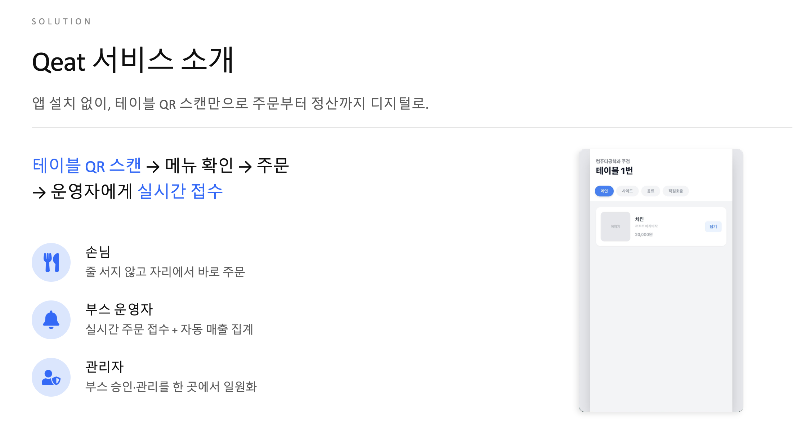
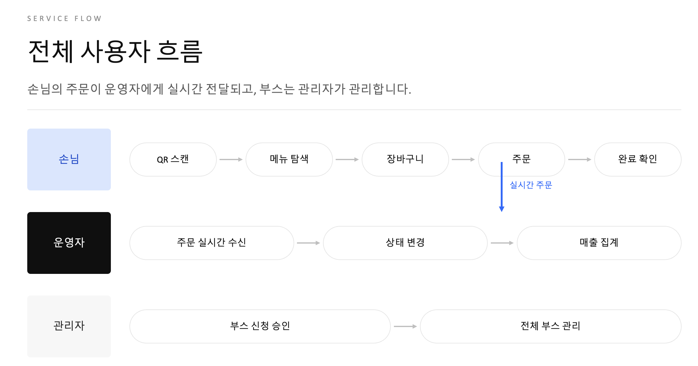
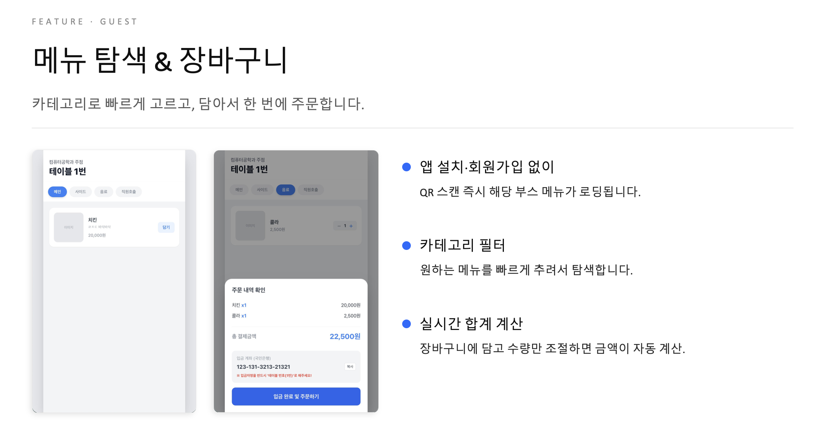
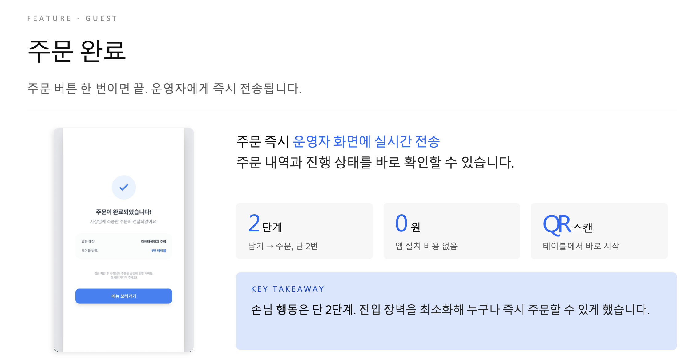
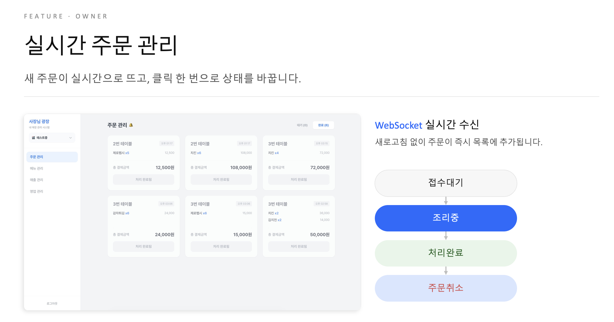
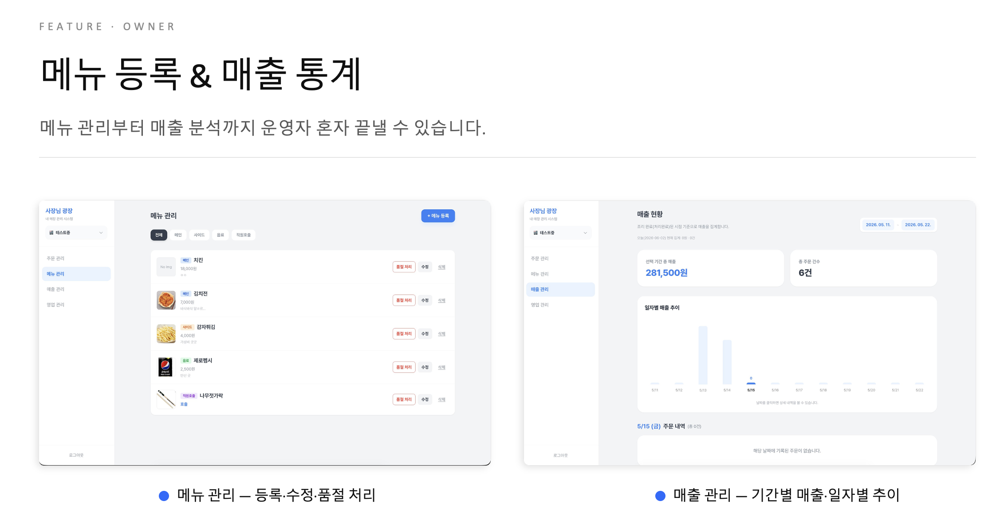
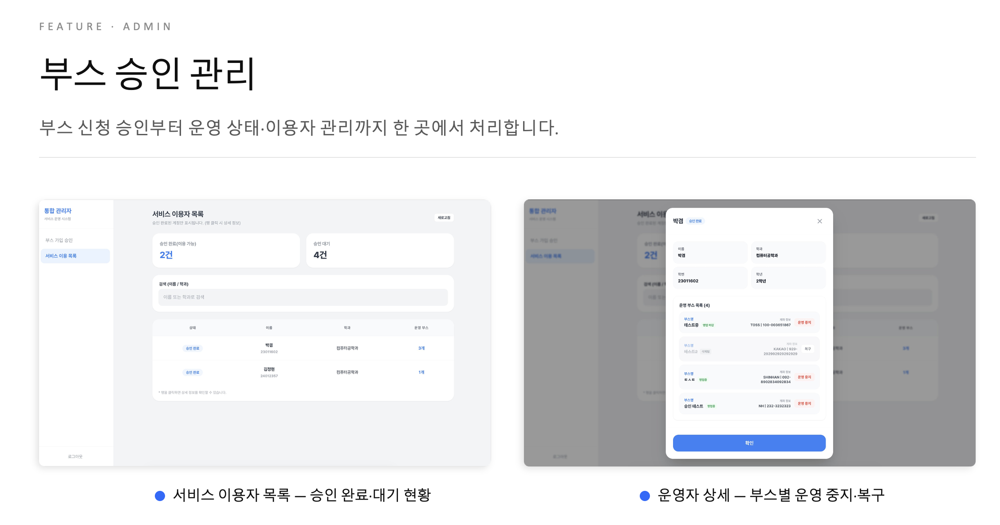

## Qeat Backend

세종대학교 축제 부스 운영을 위한 QR 주문 관리 시스템의 백엔드입니다.  
사용자는 테이블 QR을 통해 메뉴를 조회하고 주문할 수 있고, 운영자는 부스, 메뉴, 테이블, 주문, 매출을 관리할 수 있습니다.

## Overview

Qeat은 대학 축제처럼 짧은 시간 안에 주문이 몰리는 환경에서,  
복잡한 앱 설치 없이 QR 스캔만으로 빠르게 주문을 처리할 수 있도록 설계한 서비스입니다.

- 손님: QR 접속 후 비로그인 주문
- 운영자: 부스/메뉴/주문/매출 관리
- 관리자: 부스 승인 및 운영자 관리

| | |
|---|---|
| 실제 운영 | 세종대학교 축제 컴퓨터공학과 주점 부스에서 실제 손님 주문 처리 |
| 운영 환경 | 교내 Wi-Fi 내부망에 서버를 띄워 운영 (외부 클라우드 배포 없음) |
| 운영 후 개선 | 동시 주문 품절 검사 경쟁 조건을 비관적 락으로 수정, 권한 누락 API 차단 |



## My Role

이 프로젝트에서 저는 **Spring Boot 기반 백엔드 개발**을 담당했습니다.

- 부스, 메뉴, 테이블, 주문, 매출 도메인 설계
- REST API 구현
- Spring Security 기반 권한 처리
- 세션 기반 인증 처리 (Redis 세션 저장)
- MySQL 연동 및 JPA 기반 데이터 관리
- QR 주문 흐름 및 테이블 토큰 처리
- Redis를 활용한 공개 메뉴 캐시와 공개 주문 제한
- 축제 현장 운영과 운영 후 동시성·권한 문제 수정

프론트엔드는 팀원이 **React**로 담당했습니다.

## Tech Stack

- Backend: Java 21, Spring Boot, Spring Web, Spring Data JPA, Spring Security, Spring Session
- Database / Cache: MySQL 8.4, Redis 7.4
- Template / Utility: Thymeleaf, Jsoup, ZXing
- Build / Local Infra: Gradle, Docker Compose (MySQL·Redis)

## Service Flow

손님은 QR 스캔 후 바로 주문하고, 운영자는 주문 목록을 조회해 상태를 변경합니다.  
관리자는 전체 부스와 운영자 상태를 한 곳에서 관리합니다.



## Main Features

### 1. 인증 및 사용자 처리
- 세종대학교 로그인 정보 기반 인증
- JSESSIONID 세션 쿠키 기반 인증 유지
- 서버 확장을 고려해 세션을 애플리케이션 메모리가 아닌 Redis에 저장
- 운영자 / 관리자 권한 분리

### 2. 부스 관리
- 부스 생성, 조회, 수정
- 부스 승인 / 거절 / 중지 / 삭제
- 영업 상태 및 영업 시간 관리

### 3. 메뉴 관리
- 메뉴 등록, 조회, 수정, 삭제
- 이미지 업로드
- 품절 상태 관리
- 메뉴 등록/수정/삭제/품절 시 공개 메뉴 Redis 캐시 무효화

### 4. 테이블 및 QR 주문
- 부스별 테이블 생성 및 일괄 생성
- 테이블별 QR 토큰 발급
- QR 접근 시 메뉴 조회 및 주문 가능
- 공개 메뉴 조회(`GET /api/public/tables/{token}`)는 Redis에 5분 캐시
- `canOrder`는 캐시하지 않고 요청마다 계산



### 5. 주문 관리
- 주문 생성
- 주문 상태 변경
  - 입금 확인
  - 조리 중
  - 완료
  - 취소
- 상태 전이 규칙은 `Order` 엔티티에 두어, 허용되지 않은 순서로는 상태가 바뀌지 않음
- 주문 생성 시 메뉴 행을 비관적 락으로 잠가 품절 검사와 주문 생성 사이의 경쟁 조건 방지
- 여러 메뉴를 함께 주문할 때는 메뉴 ID를 정렬한 순서로 잠가 데드락 방지
- 공개 주문은 같은 테이블+IP 기준 1분에 20회까지 허용, 초과 시 429
- 주문 원본은 MySQL에 저장



### 6. 운영자 주문 처리
- 주문 목록 조회로 새 주문 확인
- 클릭 한 번으로 주문 상태 변경
- 접수 대기 / 조리 중 / 처리 완료 흐름 관리



### 7. 메뉴 및 매출 관리
- 메뉴 등록 / 수정 / 삭제 / 품절 처리
- 기간별 총 매출 조회
- 일자별 주문 수 / 매출 집계



### 8. 관리자 승인 및 운영 관리
- 부스 신청 승인 / 대기 현황 관리
- 운영자별 부스 목록 조회
- 부스별 운영 중지 / 복구 관리



## Project Structure

```text
com.qeat
├── controller
├── service
├── repository
├── domain
├── dto
├── exception
└── global
    ├── redis
    └── security
```

## Running Locally

### 1. 환경 변수 준비

프로젝트 루트에 `.env` 파일을 준비합니다.  
기본 형식은 `.env.example`을 참고하면 됩니다.

예시:

```properties
MYSQL_DATABASE=qeat
MYSQL_USER=qeat_user
MYSQL_PASSWORD=change-me
MYSQL_ROOT_PASSWORD=change-me
TZ=Asia/Seoul

DB_URL=jdbc:mysql://localhost:1000/qeat?useSSL=false&allowPublicKeyRetrieval=true&serverTimezone=Asia/Seoul&useUnicode=true&characterEncoding=utf8&connectionCollation=utf8mb4_unicode_ci
DB_USERNAME=qeat_user
DB_PASSWORD=change-me

FILE_DIR=./uploads
FILE_URL_PREFIX=/uploads
QR_BASE_URL=http://localhost:5173
SERVER_PORT=9090
REDIS_HOST=localhost
REDIS_PORT=6379
```

### 2. MySQL과 Redis 실행

```bash
docker compose up -d
```

Docker Compose 기준 포트는 다음과 같습니다.

```text
MySQL  localhost:1000 -> container 3306
Redis  localhost:6379 -> container 6379
```

### 3. 백엔드 실행

```bash
./gradlew bootRun
```

기본 실행 주소:

```text
http://localhost:9090
```

### 4. 테스트

```bash
./gradlew test
```

## API Examples

### 인증
- `POST /api/auth/login`
- `GET /api/auth/me`
- `POST /api/auth/logout`

### 부스
- `POST /api/booths`
- `GET /api/booths/my`

### 메뉴
- `POST /api/booths/{boothId}/menus`
- `GET /api/booths/{boothId}/menus`

### 테이블
- `POST /api/booths/{boothId}/tables`
- `POST /api/booths/{boothId}/tables/bulk`

### 공개 QR
- `GET /api/public/tables/{tableToken}`
- `POST /api/public/tables/{tableToken}/orders`

### 주문
- `POST /api/booths/{boothId}/orders`
- `GET /api/booths/{boothId}/orders`
- `PATCH /api/orders/{orderId}/booths/{boothId}/confirm`
- `PATCH /api/orders/{orderId}/booths/{boothId}/complete`
- `PATCH /api/orders/{orderId}/booths/{boothId}/cancel`

### 매출
- `GET /api/booths/{boothId}/sales-summary`

## Frontend Integration

프론트엔드는 React로 구현되었고, 인증은 세션 쿠키 기반으로 처리됩니다.  
따라서 인증이 필요한 요청은 반드시 쿠키를 포함해야 합니다.

```js
fetch("http://localhost:9090/api/auth/me", {
  credentials: "include",
});
```

또는 Axios 사용 시:

```js
axios.get("http://localhost:9090/api/auth/me", {
  withCredentials: true,
});
```

## 실제 운영

세종대학교 축제 기간에 컴퓨터공학과 주점 부스에서 실제 손님 주문을 받았습니다.

- 외부 클라우드 배포 없이, 교내 Wi-Fi 내부망에 서버를 띄워 운영했습니다.
- 손님도 세종대학교 Wi-Fi에 접속한 상태에서만 QR로 메뉴를 보고 주문할 수 있었습니다.
- Redis는 공개 메뉴 캐시, 운영자 세션 저장, 공개 주문 제한에 사용했습니다.
- 이 레포는 백엔드이며, 프론트엔드는 별도 React 프로젝트에서 개발했습니다.

## 운영 후 개선한 점

현장에서 사용하며 발견한 문제를 이후 코드에 반영했습니다.

| 발견한 문제 | 원인 | 해결 |
| --- | --- | --- |
| 동시 주문 시 품절 검사가 함께 통과할 수 있음 | 주문 생성 중 메뉴 상태를 잠그지 않음 | 주문 생성 시 메뉴 행을 비관적 락(`PESSIMISTIC_WRITE`)으로 조회 |
| 여러 메뉴 동시 주문 시 데드락 가능성 | 요청마다 잠그는 순서가 다를 수 있음 | 메뉴 ID를 정렬한 순서로 잠금 |
| 권한 검증이 빠진 메뉴 조회 API | 부스 운영 권한 확인 누락 | 부스 운영 권한 검증 추가 |
| 관리자 계정이 기본으로 생성됨 | 초기화 로직이 항상 실행 | 관리자 계정 자동 생성을 기본값에서 비활성화 |
| 메뉴 변경 직후 이전 메뉴가 다시 캐시될 수 있음 | 트랜잭션 커밋 전에 캐시를 삭제 | 커밋이 끝난 뒤에만 캐시를 삭제하고, 롤백 시에는 삭제하지 않음 |

## 부하 테스트

공개 메뉴 조회 API를 k6로 측정했습니다. 노트북 한 대 환경 기준이며, 자세한 조건과 결과는 [loadtest/README.md](loadtest/README.md)에 있습니다.

- 초당 800건까지 캐시 유무와 관계없이 p95 5ms 이하, 실패 0건
- 포화 구간에서 메뉴 캐시를 켜면 최대 처리량 약 16% 증가(2,135 → 2,471/s), p95 약 23% 감소
- 캐시를 켜도 요청마다 QR 토큰 확인용 테이블 조회 1개는 남기 때문에 효과가 제한적임을 쿼리 수로 확인

## 알고 있는 한계

작은 규모에서는 문제가 되지 않았지만, 트래픽이 커지면 바꿔야 할 부분입니다.

- **요청 제한의 원자성:** `INCR`과 `EXPIRE`를 따로 호출해, 그 사이 장애가 나면 만료 없는 키가 남을 수 있습니다. Lua 스크립트로 한 번에 처리하도록 바꿀 계획입니다.
- **Redis 장애 시 동작:** 현재 요청 제한은 Redis 장애 시 주문을 허용합니다. 축제 현장에서는 주문을 못 받는 것보다 낫지만, 서비스 성격에 따라 차단하는 쪽이 맞을 수도 있습니다.
- **캐시 만료 집중:** 인기 부스의 캐시가 만료되는 순간 DB로 조회가 몰릴 수 있습니다.
- **이미지 저장소:** 메뉴 이미지를 로컬 디스크에 저장해, 서버를 여러 대로 늘리려면 S3 같은 외부 저장소로 옮겨야 합니다.
- **문서화:** API 문서(Swagger)와 ERD는 아직 정리하지 않았습니다.
